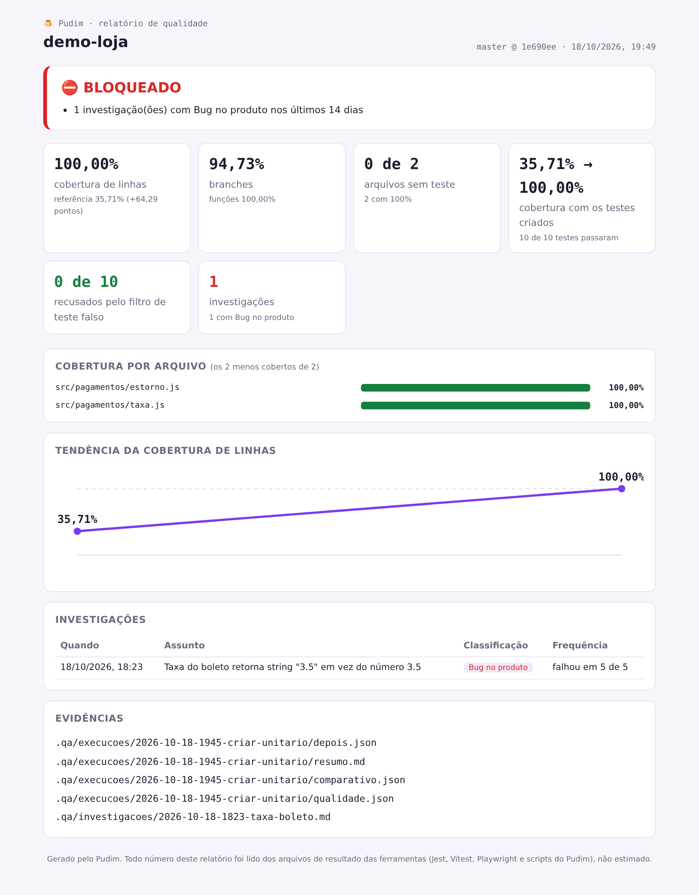
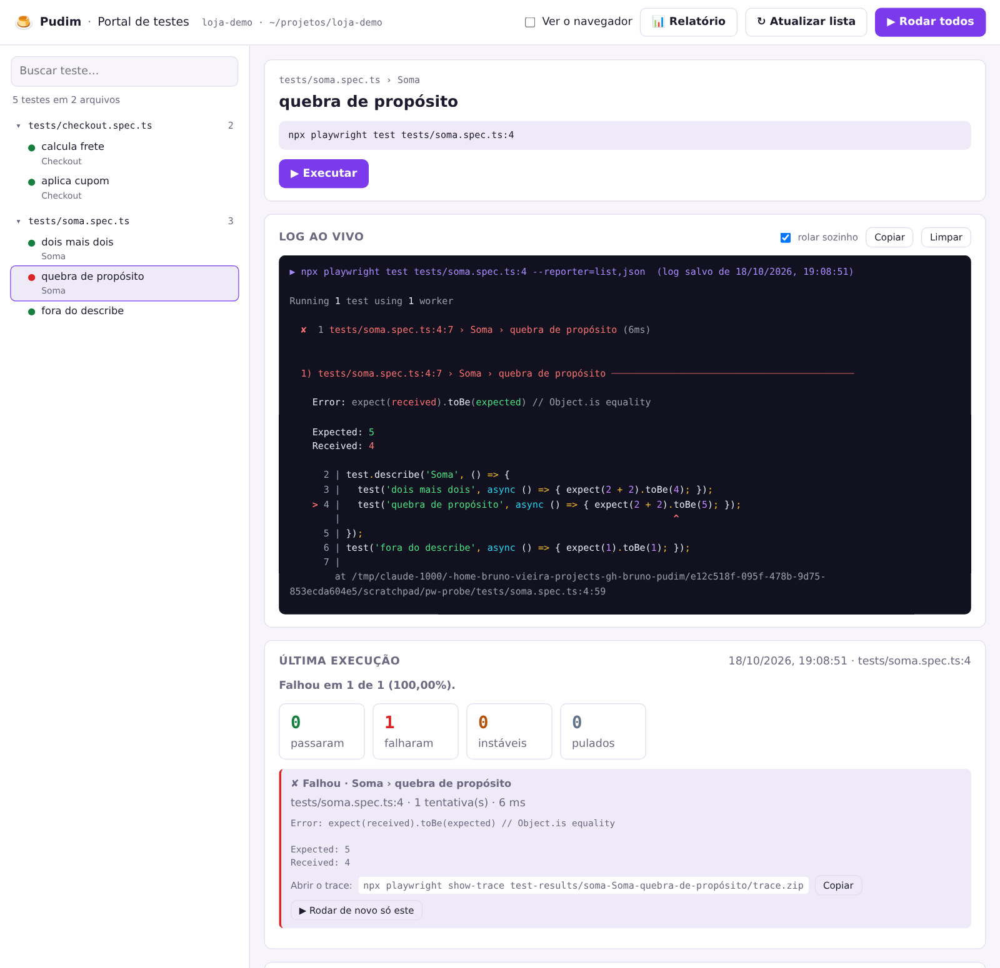

# Pudim

<p align="center">
   
</p>

<p align="center">
  <strong>Feito por QA, para QA.</strong><br/>
  O primeiro plugin especialista para QA e SDET em português do Brasil.
</p>

<p align="center">
  Plugin para Claude Code que testa um projeto que já existe: mede a cobertura com números exatos,
  cria testes unitários e E2E quando você pede, investiga falhas até a causa raiz, roda os E2E num
  portal no seu navegador, recusa teste que não testa nada e entrega o relatório de qualidade.
</p>

<p align="center">
  📖 <a href="https://pudim-spec.web.app/docs.html"><strong>Documentação completa</strong></a>
  &nbsp;·&nbsp; <a href="https://pudim-spec.web.app">Site</a>
</p>

## Para quem é

QA e SDET que recebem um produto já em desenvolvimento e precisam testar: pegar uma branch,
entender o que tem teste, criar o que falta e mostrar o resultado com números.

O Pudim **não cria sistema** e **não mexe no código do produto**. Ele só cria testes quando você
pede e guarda medições e relatórios na pasta `.qa/` do projeto testado.

## Comandos

| Comando | O que faz | Situação |
|---|---|---|
| `/pudim:cobertura [pasta]` | Mede a cobertura dos testes unitários e explica o que falta, comparando com a medição anterior | ✅ pronto |
| `/pudim:investigar <teste ou bug>` | Investiga um teste que falha ou um bug relatado com análise socrática, até a causa raiz, e diz se é bug no produto, no teste, instabilidade, ambiente ou dados | ✅ pronto |
| `/pudim:portal [parar]` | Abre no navegador um portal local (localhost) que lista os testes E2E do Playwright, roda cada um com um clique, mostra o log ao vivo e o resultado com números exatos | ✅ pronto |
| `/pudim:criar-unitario [alvo]` | Cria testes unitários (Jest ou Vitest) para o que está descoberto, recusa teste falso e mostra a cobertura antes e depois | ✅ pronto |
| `/pudim:criar-e2e [fluxo]` | Cria testes E2E com Playwright, roda cada um 3 vezes e mostra quantas rotas do app têm teste antes e depois | ✅ pronto |
| `/pudim:relatorio [jira]` | Junta tudo em um relatório visual (HTML), Markdown e comentário para o Jira, com status CONFORME ESPERADO, NECESSITA ATENÇÃO ou BLOQUEADO | ✅ pronto |

Exemplo real de resposta do `/pudim:cobertura`, em um projeto de pagamentos com Jest:

```
Cobertura de testes unitários: 35,71% das linhas (branches 26,31%, funções 33,33%)
Comparado com a referência: primeira medição, virou a referência
Testes: 2 passaram, 0 falharam
Arquivos: 2 no total, 0 com 100%, 1 sem nenhum teste

O que mais precisa de teste:
  src/pagamentos/estorno.js     0% das linhas
  src/pagamentos/taxa.js        83,33% das linhas
```

Exemplo real do `/pudim:criar-unitario --sim` no mesmo projeto (o arquivo de produto não mudou;
o teste que já falhava por causa de um bug no boleto continuou falhando, sem "ajuste" da expectativa):

```
Testes unitários criados ✅

Cobertura de linhas do projeto: 35,71% → 100%
  src/pagamentos/estorno.js   0,00% → 100%
  src/pagamentos/taxa.js      83,33% → 100%

Testes criados: 10 em 2 arquivos, 10 de 10 passaram
Filtro de teste falso: 0 recusados de 10
```

E do `/pudim:criar-e2e --sim` numa loja de exemplo:

```
Rotas com teste E2E: 1 de 4 → 3 de 4
Testes criados: 4 em 2 arquivos, cada um rodado 3 vezes: 12 de 12 execuções passaram
Filtro de teste falso: 0 recusados de 4
```

### Relatório de qualidade

O `/pudim:relatorio` lê tudo que os outros comandos guardaram em `.qa/` e gera uma página HTML
que abre sozinha no navegador (também pelo botão "📊 Relatório" do portal), um Markdown e um
comentário pronto para o Jira. O status segue regras fixas:

| Status | Quando |
|---|---|
| ⛔ BLOQUEADO | a última execução E2E falhou, ou há investigação com Bug no produto nos últimos 14 dias |
| ⚠️ NECESSITA ATENÇÃO | a cobertura caiu, há teste instável, arquivo sem nenhum teste, teste recusado pelo filtro ou possível bug encontrado ao criar testes |
| ✅ CONFORME ESPERADO | nenhum dos casos acima |

<p align="center">
  
</p>

### Portal de testes

O `/pudim:portal` sobe um portal self-service em `http://127.0.0.1:4455`. Quem não usa terminal
(outro QA, o PO, o suporte) também consegue rodar os testes E2E e ver o resultado:

- todos os testes Playwright do projeto, por arquivo, com o resultado da última vez;
- **Executar** um teste, um arquivo ou todos; **Parar** quando quiser; "Ver o navegador" para assistir;
- log ao vivo com cores e, ao final, "falhou em X de N" com o erro e o comando para abrir o trace;
- histórico salvo em `.qa/portal/`. O portal só aceita acesso da própria máquina.

<p align="center">
  
</p>

## Instalação

No Claude Code:

```
/plugin marketplace add vieiraes/pudim
/plugin install pudim@pudim
```

Depois, dentro do projeto que você quer testar, digite `/pudim:cobertura`.

Requisitos: projeto JavaScript/TypeScript com Jest ou Vitest (Playwright para E2E e para o portal), Node 18+.

## O que tem de diferente

- **Número vem de script, não da IA.** Toda porcentagem é lida dos relatórios do Jest, Vitest e
  Playwright por scripts sem dependências, versionados neste repositório.
- **O que não tem teste aparece.** A medição sempre inclui todos os arquivos de código, não só os
  que algum teste importa; o arquivo esquecido vai para o topo da lista.
- **Teste falso não conta.** O `scripts/test-quality.mjs` recusa teste sem `expect`, só com
  `toBeTruthy`/`toBeDefined`, só snapshot, pulado, com `only` ou com mock do próprio módulo
  testado. (Limite: verificação escondida num Page Object de outro arquivo não é vista; nos
  testes que o Pudim cria, o `expect` fica sempre no corpo do teste.)
- **Bug não vira teste "ajustado".** Quando o produto contraria o que a função deveria fazer, o
  teste não entra: o caso vai para `possiveis-bugs.md` e para o `/pudim:investigar`.
- **Investigação com análise socrática.** Todo problema é investigado com perguntas, cinco
  porquês e evidência exata ("falhou em 7 de 10 execuções", nunca "às vezes"), separando o que
  foi provado do que ainda é hipótese. O método está em [docs/analise-socratica.md](docs/analise-socratica.md).
- **Em português, para QA.** As respostas explicam o que o número quer dizer para o produto.

## Versões e roadmap

Versão atual: **0.4.0**. O que mudou em cada versão está no [CHANGELOG.md](CHANGELOG.md); o que vem
a seguir, no [ROADMAP.md](ROADMAP.md).

## Por que Pudim?

Porque, se fizer certinho, todo mundo gosta. 🍮

## Quem criou


**Bruno Vieira**, QA Engineer Sênior e SDET.
[LinkedIn](https://www.linkedin.com/in/bruno-vieira) · [GitHub](https://github.com/vieiraes)

Sou QA. São 9 anos no mercado financeiro, mais de 4 deles em qualidade de software, especializado
em meios de pagamento: Pix (SPI e DICT), boletos, pagamentos em lote, Open Finance e BaaS. Comecei
coordenando rollout e migração de tecnologia em bancos, corretoras e seguradoras, em ambientes
críticos de mesas de operações. Passei por operações e por Product Owner de produtos de pagamento,
e hoje construo automação E2E com Playwright e TypeScript e testes de carga com K6. Pós-graduado em
Engenharia da Qualidade de Software.

Testar pagamento ensina uma coisa: um centavo errado vira incidente. Por isso o Pudim não aceita
"acho que passou".

Criei o Pudim para quem trabalha como eu. QA e SDET precisam de ferramentas que garantam a
qualidade do trabalho, não só que acelerem. O Pudim é o meu jeito de trabalhar transformado em
plugin: investigar com análise socrática, provar com número exato, acompanhar a execução num
portal local e entregar relatório visual.

Criação, design e desenvolvimento: Bruno Vieira.

<br clear="left"/>

### História do projeto

Até a versão 0.3.2, o Pudim era um framework de desenvolvimento guiado por especificação
(SPEC → TASKS → BUILD → VALIDATION) para quem usa Claude Code e Copilot. Em outubro de 2026 ele
virou um framework para QA. A versão anterior continua no histórico do repositório.

<p align="center">
  Feito por Bruno Vieira, QA para QA &nbsp;·&nbsp; PT-BR &nbsp;·&nbsp; Licença MIT
</p>
